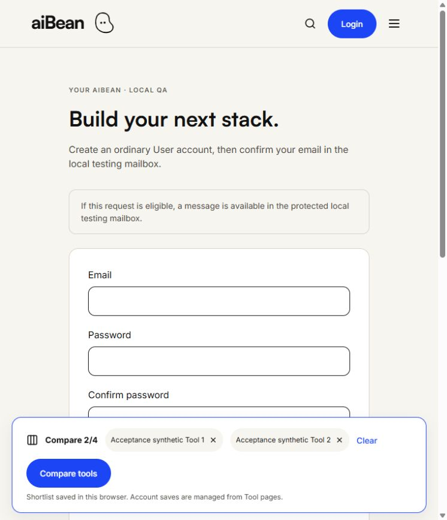
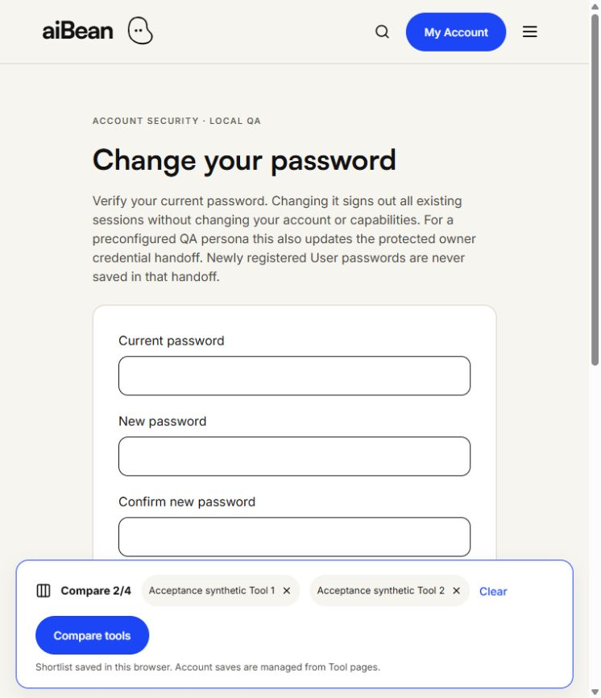

## Latest actual browser acceptance — 17 October 2026

**LOCAL WEBSITE — RUNNING; acceptance PARTIAL.** 41 actual in-app-browser observations passed, including all four unchanged fixture logins, Admin Tool creation/edit/preview/audited publication, Creator content drafts and review submission, Vendor ownership denial, and fresh ordinary registration/confirmation/login. Password replacement status and remaining owner handoffs are recorded in [the current browser report](LOCAL_BROWSER_ACCEPTANCE_20261017.md) and [per-action evidence](evidence/local-ui-browser-20261017-result.json). Older blocked/no-browser entries below are historical. No hosted connection, provider activation, schema installation or frozen source change occurred.

## Current status after preserving TLS renewal — 17 October 2026

**LOCAL WEBSITE — RUNNING:** renewal and strict native continuity verification passed, all four original passwords and the protected mailbox work, and the homepage/login pages return HTTP 200. Current lease ends at 23:10:24 EDT on October 17; renewed certificate expires October 24 at 15:10:21 EDT. All 66 application/ledger continuity checks and original identity/password hashes matched. Full suite: 167 PASS, zero FAIL. Fresh real-browser acceptance still awaits an owner-opened HTTP page. See [the actual renewal result](LOCAL_QA_TLS_RENEWAL_RESULT.md). This supersedes the expired-state entry below; earlier entries remain historical. No hosted connection or schema/data repair occurred.

## Current resumption status — 17 October 2026

**LOCAL WEBSITE — BLOCKED:** the eight-hour lease and pinned local TLS certificate have expired. All four preview ports are closed and the exact retained QA PostgreSQL cluster is stopped. Fixture and credential files remain present. No database connection, restart, certificate replacement or hosted access was attempted. The owner explicitly required stopping on TLS expiry. See [the verified blocker and proposed preserving renewal](LOCAL_QA_TLS_RENEWAL_READINESS.md). Earlier PASS/running observations below are historical.

## Current acceptance — 15 October 2026

**PARTIAL: native workflows and restart continuity verified; fresh real-browser acceptance BLOCKED.** Read [the consolidated acceptance report](AIBEAN_LOCAL_UI_ACCEPTANCE_REPORT.md) and [per-action evidence](evidence/local-ui-phase2-acceptance-matrix.json). This supersedes earlier lease/rotation/cross-port statements. Original identities/passwords, source seals, fixtures, private environment and historical evidence are preserved. No hosted connection or provider action occurred.

# Local authentication verification

October 14, 2026. Branch: `codex/supabase-foundation`. This increment uses only the owner's existing disposable native PostgreSQL QA fixture and new development source snapshots. There were no hosted Supabase connections, exports, installations, account creation or provider changes.

## Implementation and checks

| Check | Observed result |
| --- | --- |
| Full automated suite | PASS: 161 tests, zero failed; includes canonical proposal and original frozen-source checks |
| HTTP/native PostgreSQL lifecycle/security | PASS: 27 checks; [sanitized evidence](evidence/local-auth-v2-http-native.json) |
| Native database TLS/operator/target | PASS: guarded loopback PostgreSQL 17.11 fixture; certificate and hostname verification enabled |
| Four current persona passwords | PASS through actual login endpoints, including common 3000 origin; no automatic rotation |
| Ordinary signup and verification | PASS: explicit ordinary ID provisioning, unconfirmed access denied, duplicate handling, no metadata escalation |
| Password change/reset | PASS through actual HTTP endpoints, current-password checks, old credential rejection, new credential acceptance, all-session revocation |
| Security negatives | PASS: CSRF, token purpose/expiry/replay, recovery/business separation, concurrent signup/token consume, atomic throttling, capability denial, transaction rollback |
| Concurrent change versus token exchange | PASS: account lock serializes replacement with exchange; no surviving recovery authorization after replacement |
| Audit | PASS: registration, confirmation, change/reset events contain no credentials, email or tokens |
| Private local schema | PASS: six RLS tables; anon/authenticated/service roles denied schema/table access; restricted runtime cannot edit Admin/Creator columns |
| Existing cross-account and Tool-owner predicates | PASS in full automated suite; previous native/browser feature evidence retained separately |
| Lint / TypeScript | PASS; actual generated QA overlay snapshot also type-checked |
| Isolated production build | PASS; no private environment copied or hosted connection configured; [evidence](evidence/local-auth-v2-build.json) |
| Runtime dependency audit | PASS: zero runtime vulnerabilities |
| Frozen Creator Content mechanism | PASS: original exact seal and all 170 dependencies unchanged |
| Private `.env.local` | Original retained; restart continuity evidence is recorded separately when the final restart completes |
| Deliberate four-persona rotation | Implemented, not performed; no claim of a live rotation test |

The new [source-overlay proposal](../db/proposals/local-qa-auth-v2/change-proposal.json) binds 24 canonical-LF source dependencies and 16 generated overlays. SHA-256: `4949fa4056c93785e788c813676cc53c030a32f2dafaf7443ef2dfcfd29aebe5`. It grants no hosted installation authority. Original frozen production Auth files are replaced only inside explicit local development snapshots. Original Creator Content SQL/mechanism and historical recovery artifacts remain unchanged.

## Real browser record — still incomplete

PASS: actual mobile-browser registration with a fresh synthetic email; generic submission feedback; owner-protected local mailbox sign-in; matching registration confirmation; successful confirmed-account login; real User dashboard; Account security link and form.

The browser tool requires the owner to enter and submit changed/reset credentials. The password-change handoff is pending. A browser submission returned a current-password rejection, without a credential replacement. The owner could not remember the synthetic password and reported that the AppData folder was absent in the desktop view. File-handle inspection confirmed Codex Desktop AppData virtualization: the actual file is in the package's private cache. A new desktop-aware helper opens the physical backing file, preserving its owner/SYSTEM permissions; all four real login probes pass. The sealed v2 source/proposal remains unchanged, with a separately versioned desktop-access extension. No password or physical private path was published.

Still pending in this increment: owner-completed successful browser password change, subsequent browser forgot/reset flow, four-persona browser sign-ins/rendering under this new adapter, final restart continuity and final owner confirmation of private Notepad retrieval. Earlier four-panel browser checks used the prior adapter and are historical, not substitutes for these checks. Do not classify this as a complete browser end-to-end PASS yet.

## Preserved failure evidence and limits

The first HTTP suite incorrectly treated streamed Next.js redirects with HTTP 200 as granted access. Inspecting the actual redirect destination confirmed denial; test assertions were corrected without weakening application authorization. [Initial evidence](evidence/local-auth-v2-initial-http-native.json) is retained. A sandboxed full-suite attempt could not create Windows junctions/use a loopback scanner; the complete authorized native run subsequently passed.

Docker's Linux engine was unavailable during inspection. The candidate Supabase configuration binds the hosted project, so the requested local-only fallback was used without provider settings or frozen-code changes. This does not verify hosted Supabase Auth, real SMTP, Stripe, Storage/scanner or affiliate operation. The finite local TLS certificate, lease and owner-only synthetic mailbox remain development limits.

Implementation commit `108b729b3bf9a953c6d8e68d76d1397404f34303` is verified on the remote branch. [Validate 38617677711](https://github.com/nzagha/aibean/actions/runs/38617677711) completed successfully, including lint, TypeScript, all tests, production build and runtime audit; [observed CI evidence](evidence/local-auth-v2-ci.json). Desktop-access correction `c507912748a4d9fa4625a3807eee607dfd89590a` is also verified remotely and [Validate 38619181447](https://github.com/nzagha/aibean/actions/runs/38619181447) completed successfully; [separate observation](evidence/local-auth-v2-desktop-ci.json). Native PostgreSQL and browser tests remain separate from Linux CI and must not be represented as hosted tests.

The active User form was preserved for owner input. Final preview restart to load the last source changes, restart continuity proof and remaining browser actions are deliberately pending until that handoff completes. The saved active manifest retains the current runner/ports/lease; the website is still listening only on loopback. This is an unfinished acceptance gate, not a hosted-release failure.
