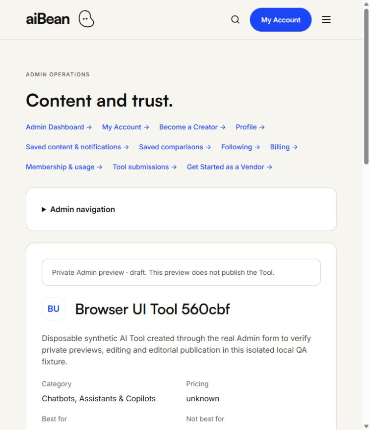
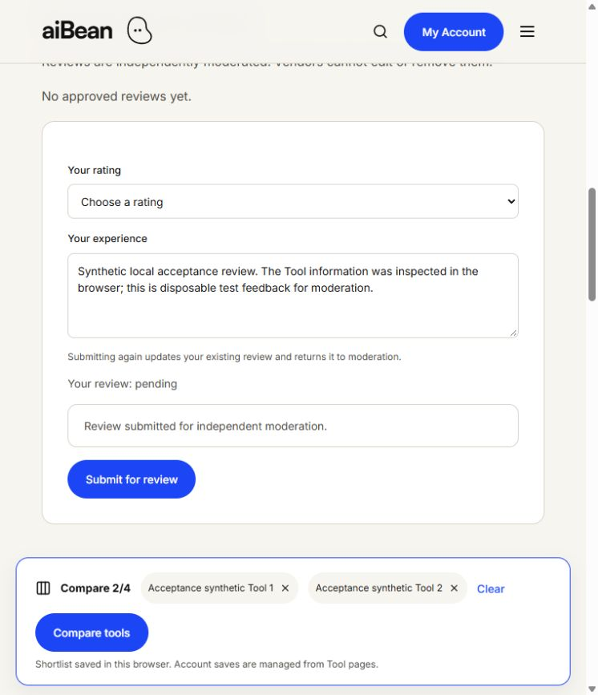

# Local browser acceptance — 17 October 2026

Status: **PARTIAL**. These are actual Codex in-app-browser actions against the preserved disposable PostgreSQL fixture. Earlier native checks and route rendering are reported separately. Source commit: `ecb2efddfb7c7484aa72e49dc14cd96f10912d45`. No app implementation or frozen package was edited during this browser run.

## Access

Homepage: http://127.0.0.1:3000/ . All four fixture passwords were used unchanged in the actual browser and worked.

| Persona | Login | Panel |
| --- | --- | --- |
| User | http://127.0.0.1:3000/login | /account |
| Admin | http://127.0.0.1:3002/login | /admin |
| Creator | http://127.0.0.1:3003/login | /creator |
| Vendor | http://127.0.0.1:3004/login | /vendor |

The 3000 origin also supports all roles. Ports share hostname cookies; they are not isolated browser profiles. Use distinct browser profiles for simultaneous role tests. Lease expiry is October 17, 23:10:24 EDT; current local certificate expires October 24, 15:10:21 EDT. Availability is finite, not guaranteed beyond lease/shutdown.

From the repository root, retrieve the four original passwords privately:

~~~powershell
powershell.exe -NoProfile -File scripts/local-website-qa/open-desktop-test-access.ps1
~~~

The new disposable browser account uses a separate existing owner-protected handoff, opened through the verified physical file handle. Credentials are not copied into this repository. Protected mailbox: http://127.0.0.1:3000/local-mailbox ; synthetic messages only, no external delivery.

## Actual cases

78 PASS observations currently recorded. This count includes navigation/access and mutations, not 78 complete product journeys. The [structured evidence](evidence/local-ui-browser-20261017-result.json) includes expected/actual outcomes and screenshot links. Non-public original workspace screenshots are retained privately.

| Case | Persona | Route | Action | Status | Observed result |
| --- | --- | --- | --- | --- | --- |
| 1 | User | /account | Sign in with unchanged fixture password | PASS | Your next moves, saved Tools, Stacks and User workspaces visible |
| 2 | User | /account | Create and rename a new disposable Stack | PASS | Stack created and Your changes are saved; original fixture headings still present |
| 3 | User | /account | Delete only the new disposable Stack | PASS | New Stack heading disappeared; original Stacks remain |
| 4 | User | /admin | Open Admin directly | PASS | Redirected to account?notice=admin-required with Admin access is required |
| 5 | User | /account | Sign out | PASS | Login page displays You have been signed out |
| 6 | Admin | /admin | Open operational dashboard | PASS | Content and trust dashboard rendered current counts and recent Stack activity |
| 7 | Admin | /admin/tools/new | Create new synthetic Tool draft | PASS | Draft created. Review its private preview before publication. |
| 8 | Admin | /admin/tools/[new-id]/preview | Inspect private draft preview | PASS | Private Admin preview · draft, Not awarded, Last Verified Never |
| 9 | Admin | /admin/tools/[new-id] | Edit Tool description with reviewer reason | PASS | Tool content saved. Trust and ownership remain subject to independent review. |
| 10 | Admin | /admin/tools/[new-id] | Request publication once | PASS | Owner confirmed the single existing dialog; browser now shows Current status published and Publication status updated and audited. |
| 11 | Admin | /admin/audit?entity=[new-id] | Inspect new Tool audit history | PASS | Three entries visible: tool.created, tool.edited and tool.published; reason and changed field recorded |
| 12 | Admin | /creator | Open Creator workspace as Admin | PASS | Redirected to account?notice=creator-required with Approved Creator access is required |
| 13 | Creator | /creator | Sign in and open approved Creator workspace | PASS | Creator workspace shows Skills, Playbooks, Events, resources and Proposed / Preview Free membership |
| 14 | Creator | /creator/content/skills/new | Create Skill with published Tool reference | PASS | Draft saved. Publication requires independent Admin review. |
| 15 | Creator | /creator/content/skills/[new-id] | Edit the new Skill draft | PASS | Draft saved. Publication requires independent Admin review. |
| 16 | Creator | /creator/content/skills/[new-id] | Submit Skill for review | PASS | Status changed to pending, No editorial decision yet; submit action removed |
| 17 | Creator | /creator/content/playbooks/new | Create Playbook with two steps and reorder controls | PASS | Move up/down changed visible step order; Draft saved with independent review requirement |
| 18 | Creator | /creator/content/playbooks/[new-id] | Reopen saved Playbook | PASS | Saved draft shows Inspect the synthetic Tool first and Record the synthetic outcome second; 30 minutes; free-to-read invariant |
| 19 | Creator | /creator/content/playbooks/[new-id] | Submit new Playbook | PASS | Status pending; Creator submission action removed |
| 20 | Creator | /creator/content/events/new | Create future virtual Event draft | PASS | Draft saved; independent Admin review required |
| 21 | Creator | /creator/content/resources/new | Create resource campaign draft | PASS | Draft saved; no publication or external payment |
| 22 | Creator | /creator/analytics | Read analytics | PASS | No requests or conversions shown; no false revenue |
| 23 | Creator | /admin | Direct Admin access | PASS | Redirected account with admin-required notice |
| 24 | Vendor | /vendor | Login and view ownership dashboard | PASS | One owned synthetic Tool; settlement disabled; sponsorship $99/five days |
| 25 | Vendor | /vendor/tools/:ownedTool | Inspect pending edit and verification | PASS | Both requests pending; payment required; duplicate forms unavailable |
| 26 | Vendor | /vendor/tools/:ownedTool/analytics | Read owned Tool analytics | PASS | No conversions/commissions falsely reported |
| 27 | Vendor | /vendor/tools/:unownedTool | Direct request access to new Admin-created Tool | PASS | Approved ownership required; request controls absent |
| 28 | Vendor | /admin | Direct Admin access | PASS | Admin required |
| 29 | Vendor | /creator | Direct Creator access | PASS | Approved Creator required |
| 30 | Fresh User | /register | Register ordinary synthetic identity | PASS | Eligible confirmation message notice shown |
| 31 | Fresh User | /login | Login before email confirmation | PASS | Verification-incomplete generic credential denial |
| 32 | Fresh User | /local-mailbox | Unlock protected mailbox | PASS | New synthetic confirmation message present; no external email |
| 33 | Fresh User | /login?status=verified | Confirm email through mailbox | PASS | Email confirmed. Sign in to continue |
| 34 | Fresh User | /account | Login after confirmation | PASS | Confirmed login succeeded; ordinary navigation only |
| 35 | Fresh User | /tools/:newTool | Save Tool | PASS | Tool saved to your account; Remove from saved available |
| 36 | Fresh User | /tools/:newTool | Follow Tool | PASS | Following saved; count one; Unfollow available |
| 37 | Fresh User | /tools/:newTool#reviews | Submit review | PASS | Your review pending; no approved review falsely shown |
| 38 | Fresh User | /tools/:newTool | Remove saved Tool | PASS | Removed from your saved tools; Save tool restored |
| 39 | Fresh User | /account/security | Open security form | PASS | Current/new/confirmation fields visible; no elevated capabilities |
| 40 | Fresh User | /account/security | Owner enters and submits password change | PASS | Password updated; signed out; sign in again |
| 41 | Fresh User | /login | Login with previous password after change | PASS | Credential denial shown after old password submission |
| 42 | Fresh User | /login | Owner logs in with changed password | PASS | Ordinary User dashboard and pending review preserved |
| 43 | Fresh User | /admin | Direct Admin access after password change | PASS | Admin required notice |
| 44 | Fresh User | /creator | Direct Creator access after password change | PASS | Approved Creator required |
| 45 | Fresh User | /vendor/tools/:fixtureOwnedTool | Access another account owned Tool after password replacement | PASS | Approved Tool ownership required |
| 46 | Fresh User | /account | Logout after changed-password login | PASS | Signed out notice |
| 47 | Fresh User | /forgot-password | Request recovery email | PASS | Eligible message notice; no external email |
| 48 | Fresh User | /local-mailbox | Read new recovery message | PASS | Recovery message received in protected mailbox |
| 49 | Fresh User | /reset-password | Exchange recovery message | PASS | Reset form opened at clean URL |
| 50 | Fresh User | /reset-password → /account | Owner resets password and logs in | PASS | Owner reported reset/login; browser shows same ordinary account and pending review |
| 51 | Fresh User | /account/profile | Save new private profile | PASS | Draft status and synthetic fields persist; public publishing unavailable |
| 52 | Fresh User | /compare?tools=fixture1,fixture2 | Save named two-Tool comparison | PASS | Comparison saved to your account |
| 53 | Fresh User | /account/comparisons/:newId | Reopen saved comparison | PASS | Named private comparison reopened with both fixture Tools selected |
| 54 | Fresh User | /local-mailbox | Replay consumed recovery message | PASS | Expired, invalid or already used; no reset grant issued |
| 55 | Fresh User | /local-mailbox | Replay consumed confirmation message | PASS | Already-used invalid-link state persists; no new confirmation |
| 56 | Fresh User | /account/billing | Inspect billing empty state | PASS | No request payments; Free preview; sandbox only |
| 57 | Fresh User | /account/membership | Inspect free limits and actual usage | PASS | Free status, one comparison and one follow; Creator content quotas zero |
| 58 | Fresh User | /account/following | Verify follow after password reset | PASS | One newly followed Tool shown |
| 59 | Fresh User | /account/following | Unfollow new Tool | PASS | Zero followed targets; No follows yet |
| 60 | Fresh User | /account/activity | Read notifications and saved-content state | PASS | Empty account-scoped lists; No notifications yet |
| 61 | Fresh User | /account/stacks/:newId | Save private Stack notes | PASS | Stack ordering and visibility saved; no public Creator profile |
| 62 | Fresh User | /tools/:newTool | Add new Tool to fresh Stack | PASS | Tool added to your stack |
| 63 | Fresh User | /tools/acceptance-tool-1 | Add second Tool to fresh Stack | PASS | Tool added to your stack |
| 64 | Fresh User | /account/stacks/:newId | Reorder two Tools and reload | PASS | Browser Tool first, fixture Tool second after reload; notes retained |
| 65 | Admin | /admin/content/skills/:newId | Independently approve Creator Skill | PASS | Published; editorial decision saved, audited and author notified |
| 66 | Admin | /admin/reviews | Approve only new synthetic User review, then filter approved | PASS | New Tool review appears approved, rating four; pending queue removed it |
| 67 | Admin | /admin/claims | Inspect claim queue only | PASS | Zero pending matching claims; no decision made |
| 68 | Admin | /admin/disputes | Inspect dispute queue only | PASS | Zero matching disputes; no decision made |
| 69 | Admin | /admin/creators | Inspect application queue only | PASS | Zero matching pending applications; no capability granted |
| 70 | Admin | /admin/verification | Inspect existing verification only | PASS | One pending request, payment required; checklist independent; existing request unchanged |
| 71 | Admin | /admin/featured | Read placement queue | PASS | No requests; approval allows checkout; confirmed payment activates placement |
| 72 | Admin | /admin/commerce/payments | Read payment queue | PASS | Zero matching sandbox payments; capabilities/rank separate |
| 73 | Admin | /admin/commerce/pricing | Inspect configuration only | PASS | Proposed/Preview; exact configuration approval required; no refund requests; no edits |
| 74 | Admin | /admin/commerce/subscriptions | Inspect subscription queue | PASS | No matching subscription records; no cancellation/provider activation |
| 75 | Admin | /account/stacks/:otherUserNewId | Open another User private Stack directly | PASS | 404; private Stack title/notes/order not disclosed |
| 76 | Admin | /account/comparisons/:otherUserNewId | Open another User private comparison | PASS | 404 without private name or Tool membership |
| 77 | Admin public browsing | /events/:newDraftSlug | Open unpublished Event public URL | PASS | 404; no draft Event body exposed |
| 78 | Admin public browsing | /skills/:newPublishedSlug | Read published Skill after independent approval | PASS | New Skill public page shows instructions, outcome, author and Browser Tool reference |

## Publication interruption

The Admin Tool publication action was submitted once. The native JavaScript confirmation blocked browser inspection and the documented dialog API returned no dialog. No repeat submission occurred. The owner confirmed the existing dialog. The browser then showed published status, publication success and three audit entries: created, edited and published. The earlier [interruption observation](evidence/local-ui-browser-20261017-publication-interruption.json) remains historical; it predates confirmation and is not the final publication state. This is a browser-control limitation, not a demonstrated application defect. A separate strict-TLS read-only local postflight also confirms published status and exactly one Tool-created, edited and published action. Its initial assertion expected only three total entity actions; later User follow/review actions correctly added two more. The observer was corrected to assert the lifecycle subset separately; original failure and diagnostic evidence are retained. No application or database fix was required.

## Authentication gate

Fresh registration, denial before confirmation, local message receipt, confirmation, confirmed login and Account Security are PASS in the browser. The owner performed password replacement; the browser displayed Password updated, the old password was rejected, and owner login with the changed password opened the ordinary dashboard. Admin, Creator and Tool-owner boundaries still denied the fresh User. Forgot-password submission, local recovery-message receipt and token exchange to the clean reset form passed. The owner also completed reset and subsequent login; the ordinary dashboard was independently observed, and a separate read-only audit confirms exactly one password-reset event. Replayed recovery and confirmation messages are rejected. The reset success toast itself was not independently captured. [Local read-only Auth audit and ordinary capability evidence](evidence/local-ui-browser-20261017-auth-postflight.json) confirms committed registration, confirmation, change and reset events without reading password hashes or authenticating with the changed/reset credential. Changed/reset credential entry must remain owner-operated under the browser confirmation policy. A successful native HTTP test is not a substitute. Do not mark unperformed owner steps PASS.

## Remaining detailed acceptance

| Work | Browser status / limitation |
| --- | --- |
| Incorrect-current-password negative on this new identity | NOT TESTED; prior native negative PASS retained |
| Password change/reset follow-up logins and reset submission | PASS with owner entry/submission; subsequent dashboards observed; reset audit independently verified |
| Distinct simultaneous browser profiles and all-session UI invalidation | NOT TESTED; one shared browser cookie jar; native regression evidence retained |
| User Stack Tool ordering and saved named comparisons | PASS: two memberships, move/save/reload, named comparison save/reopen |
| User follows | Tool follow, reset continuity and unfollow PASS; Creator follow/unfollow NOT TESTED in this browser run |
| User profile | PASS: fresh ordinary private profile saved; no public Creator capability |
| User activity, billing and membership | PASS for named read-only empty/usage checks; no payment mutation claimed |
| Independent Admin moderation | Skill publication PASS with owner confirmation; User review independently approved and verified in the approved queue; Playbook prepared for owner action |
| Admin archive eligibility and claims/disputes/Creator applications/verification adjudication | Archive NOT TESTED; claim/dispute/application decisions BLOCKED by empty pending queues; existing verification remains payment-required and preserved. Named queue-read cases PASS; prior native mutations are separate |
| Admin pricing/subscription/payment/featured queue UI | PASS for named read-only states: empty queues and explicit sandbox/preview gates. No provider success claim |
| Existing Creator profile changes, peer Creator draft isolation, unpublished content preview | NOT TESTED in this browser run; original profiles preserved |
| New Vendor edit/verification proposal submission | BLOCKED by existing pending requests; duplicates not created and previous requests preserved |
| Vendor Tool owned by a different Vendor | NOT TESTED as a separate browser case; tested unowned Admin-created Tool denial is narrower |
| Forged/concurrent Server Actions, invalid transitions, rollback | Native tests only, not browser mutation acceptance |
| External SMTP, hosted Supabase Auth, Stripe settlement, Storage scanning/downloads, affiliate activation | BLOCKED by intentionally unavailable provider prerequisites and separate owner approval |

## Validation and continuity

Same implementation validation on October 17: [167 automated tests, lint, TypeScript, isolated production build, zero runtime vulnerabilities](evidence/local-qa-tls-renewal-v1-validation.json); [CI 39061861880](https://github.com/nzagha/aibean/actions/runs/39061861880) SUCCESS for the source commit above. Earlier native auth27, access198, workflows71 and discovery23 PASS remain [separate October 15 observations](AIBEAN_LOCAL_UI_ACCEPTANCE_REPORT.md). [Browser-evidence commit d02f35de154d70c8dad802f0e3e94ec195555dfc](https://github.com/nzagha/aibean/commit/d02f35de154d70c8dad802f0e3e94ec195555dfc) is verified remotely; [its exact CI 39063792130](https://github.com/nzagha/aibean/actions/runs/39063792130) completed SUCCESS, including build and runtime audit. This is Linux CI, separate from actual browser/native observations. [Follow-up commit 5323d66123fa8b579108968d27c28efd05b07572 CI](https://github.com/nzagha/aibean/actions/runs/39064065276) and [recovery/User workflow commit 86c5d0376a1d71a2cf316298c29da0b5f95939de CI](https://github.com/nzagha/aibean/actions/runs/39064625187) also completed SUCCESS. No schema migrations or installations were rerun.

[Five frozen manifests and all 214 dependencies match](evidence/local-ui-browser-20261017-seals.json): Creator Content170, local Auth24, desktop helper1, Phase2 observers16, TLS renewal3. The preserving restart/TLS renewal already verified 66 relation continuity digests, identities/password hashes, private environment and mailbox before these new browser mutations. The records newly created today have not been claimed as independently verified across a later restart.

Only new task-specific synthetic User profile/comparison/Stack/Tool/Skill/Playbook/Event/resource/review data was created through ordinary UI workflows. Only the new disposable Stack was deleted. Existing content, pending Vendor requests, all four provisioned passwords, historical recovery targets and backups remain preserved. No hosted connection occurred.

## Priorities and handoff

- P0: no confirmed new application defect.
- P1 acceptance gate: complete remaining password negatives and separate-profile session checks, independent moderation and detailed panel workflows; successful owner change/reset/logins and consumed-token replay are recorded.
- P1 provider readiness: hosted Auth/SMTP/payments/Storage remain intentionally unavailable; require separate reviewed approvals.
- P2 QA limitations: native modal control requires owner confirmation; separate real browser profiles and wider desktop/accessibility coverage remain unverified.
- P2 availability: eight-hour lease and finite local certificate require the reviewed preserving restart/renewal procedure; never disable TLS validation.

Screenshots are synthetic, visually reviewed before publication, and contain no password/token/private filesystem path. Current browser developer-console inspection is not claimed; no captured console error evidence is available. Keep historical failures and initial result files as historical evidence.

