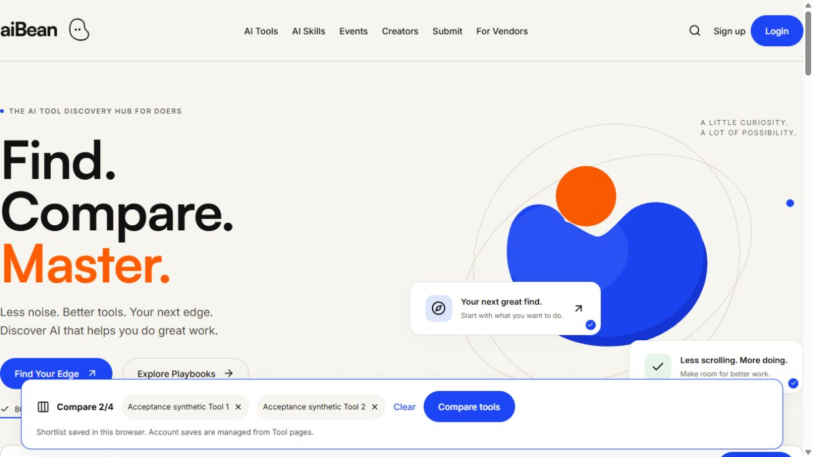

# Local website recovery result

Observed on October 14, 2026. Scope: local Windows development only, on `codex/supabase-foundation`. No public deployment or hosted Supabase inspection was performed.

## Result and diagnosis

**RUNNING:** `http://127.0.0.1:3000/`, with separate Admin, Creator and Vendor previews on ports 3002, 3003 and 3004. These are isolated synthetic previews, not the hosted database. Availability is bounded by the active preview lease; see the restart procedure below.

The initial inspection found no listeners on 3000, 3001, 54329 or 63799. Therefore no native Next.js server or Docker web service was serving the expected address. Docker Desktop was healthy, but no aiBean web/database/Redis containers existed. Unrelated stopped containers and unrelated Node processes were left untouched. Historical retained PostgreSQL targets were stopped; their involvement in the outage was not established. The reason the earlier website process stopped is **unverified**.

Node 24.14.0, npm 11.9.0 and installed Next.js 16.3.8 were available. Required dependencies were installed. The existing `.next` directory was preserved. `.env.local` contained a protected hosted runtime connection, so running the ordinary native or Docker profile with synthetic writes would not satisfy the requested isolation.

## Repairs and preview implementation

- Added the missing `/categories` and `/use-cases` index routes. They reuse existing typography, grid classes and approved taxonomy data; existing assets, header, footer and layout were not redesigned.
- Added `scripts/local-website-qa/`: a loopback-only PostgreSQL 17 fixture and four genuine password-mode application processes, using the existing authorization and restricted database runtime rules.
- Generated distinct strong credentials and session secrets privately. Explicit Admin/approved-Creator/Tool-owner capabilities exist only in this new disposable fixture.
- Apply restricted Windows ACLs during fixture creation and store active QA credentials in a separately protected owner-and-SYSTEM-only LocalAppData folder outside OneDrive. The final check detected reintroduced workspace ACL inheritance, so the active handoff was moved out of the workspace and reverified. Disposable synthetic workspace files remain gitignored. No private environment file was copied or changed. Child environments exclude hosted/provider credentials.
- Use separate source snapshots and default Turbopack development compilation. Four shared webpack previews caused local memory pressure and a cold-render timeout during testing; separate snapshots also prevent generated type-file collisions.
- Fixed test infrastructure to include reviewed public database metadata in snapshots and use Next.js 16's actual Server Action encoding. These were local QA defects, distinct from the original absence of a listener.

The fixture applies existing reviewed packages only to its newly initialized disposable local database. Frozen SQL, all 170 Creator Content readiness dependency hashes, existing volumes, recovery artifacts and historical evidence remain unchanged. No hosted connection, migration, account, email or payment occurred.

## Start, persistence and shutdown

From the repository root in the integrated terminal:

```powershell
powershell.exe -NoProfile -File scripts/local-website-qa/start.ps1
```

This launches a hidden persistent runner, a new native PostgreSQL 17 cluster and four loopback Next.js processes. It requires the already installed PostgreSQL 17 portable binaries and Git OpenSSL; it does not download them. Startup is asynchronous. `test-results/local-website-qa-active.json` is written after all four apps are ready and contains the current URLs, runner PID and expiry. It is private and ignored by Git.

The runner has a **110-minute lease from fixture setup**. It survives the initiating terminal command, but is not an installed Windows service and does not survive reboot. Its expiry or an explicit stop shuts down only its own processes and retains its data directory. The earlier preview expired during a task pause; a fresh preview was then started and checked again. The current expiry is available privately with:

```powershell
$qa = Get-Content .\test-results\local-website-qa-active.json -Raw | ConvertFrom-Json
[DateTimeOffset]::FromUnixTimeMilliseconds($qa.expiresAt).ToLocalTime()
```

To stop, then restart after the listeners close:

```powershell
powershell.exe -NoProfile -File scripts/local-website-qa/stop.ps1
powershell.exe -NoProfile -File scripts/local-website-qa/start.ps1
```

Restart creates fresh fixtures and credentials. It retains previous fixture folders; it never deletes or reuses historical recovery targets. Do not start another preview while these ports are occupied. Source snapshots are fixed at startup: after code changes, restart to test the new source.

## Verification

Actual HTTP/native PostgreSQL evidence: [HTTP QA](evidence/local-website-http-qa.json). This covers signed login/logout, all requested public routes and panel route inventories, assets, TLS/runtime identity, access denials, private draft/Stack isolation, an Admin draft action and rejected invalid/forged actions. Browser evidence covers genuine User Stack creation, Admin rendering, Creator private draft creation, Vendor pending edit requests, mobile navigation, search and comparison. See the [matrix](FOUR_CONTROL_PANELS_QA_MATRIX.md) for tested versus untested workflows.

Automated suite: 157 passed, zero failed. Final fresh-fixture HTTP suite: 195 passed, zero failed across 92 route/access observations and additional action/security checks. Five native PostgreSQL checks passed, including protected Admin/Creator capability column denials and transaction rollback. Lint and TypeScript passed. An isolated production webpack build passed without private environment files or configured hosted connections: [build evidence](evidence/local-website-qa-build.json). Runtime dependency audit found zero vulnerabilities. Local results are separate from GitHub Actions; publication/CI evidence is recorded in `docs/evidence/local-website-qa-publication.json` once observed.

Initial failed QA runs are retained in the new `local-website-qa-initial-http`, `local-website-qa-snapshot-first-http` and `local-website-qa-transport-first-http` evidence files. They document the route repairs, test expectation corrections and snapshot/transport fixes rather than concealing them.


